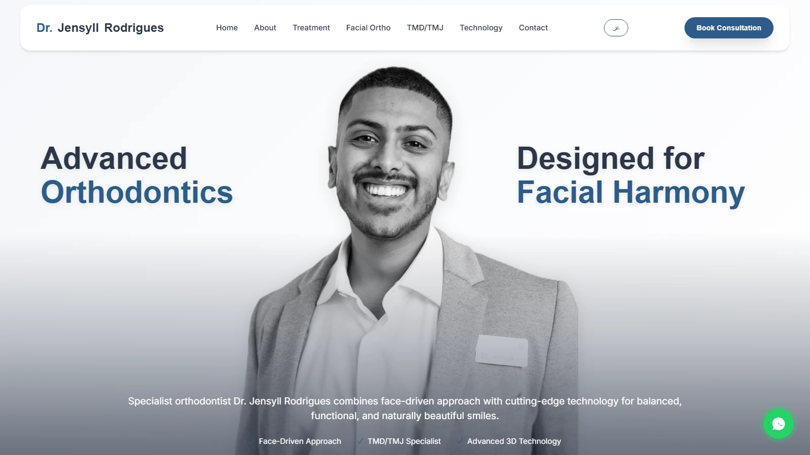

# Dr. Jensyll Rodrigues website

Single-page website for Dr. Jensyll Rodrigues, a specialist orthodontist in Dubai, with an English page and a right-to-left Arabic page. It introduces his face-driven approach, his TMD/TMJ therapy and the technology he uses, shows before and after results, and points visitors to a consultation booking. I built it in plain HTML, CSS and JavaScript in November and December 2025.



## What it does

- Draggable before and after comparison sliders, inside two carousels (a compact results strip and a full gallery), with mouse and touch support.
- An English page and an Arabic page (`dir="rtl"`) that link to each other from the navigation bar.
- An about section that fades in on scroll with an IntersectionObserver and counts its figures up when it comes into view.
- Expandable treatment cards, a rotating testimonials carousel, a mobile menu and a floating WhatsApp button.
- Schema.org `Dentist` markup and a reduced-motion mode that turns the animations off.

## Stack

HTML, CSS and JavaScript in one file per language. No framework, no build step. Fonts load from Google Fonts.

## Run it locally

Open `index.html` in a browser, or serve the folder:

```bash
npx serve .
```

## Credits

Built for Dr. Jensyll Rodrigues. The before and after images, testimonials and contact details in this repo are placeholders. Dr. Jensyll Rodrigues's name and photographs belong to him and are not covered by the licence.

## Licence

MIT, for the code only. See [LICENSE](LICENSE).
